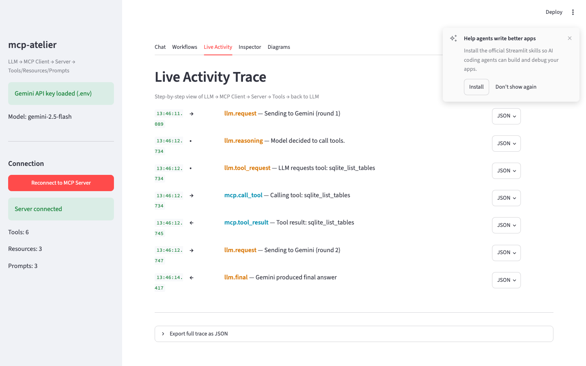
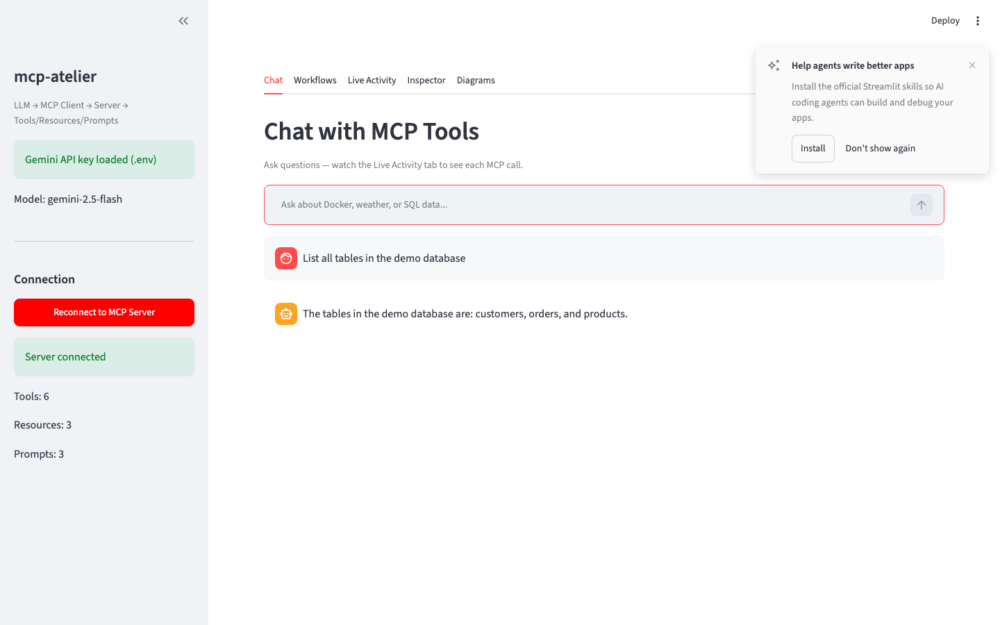
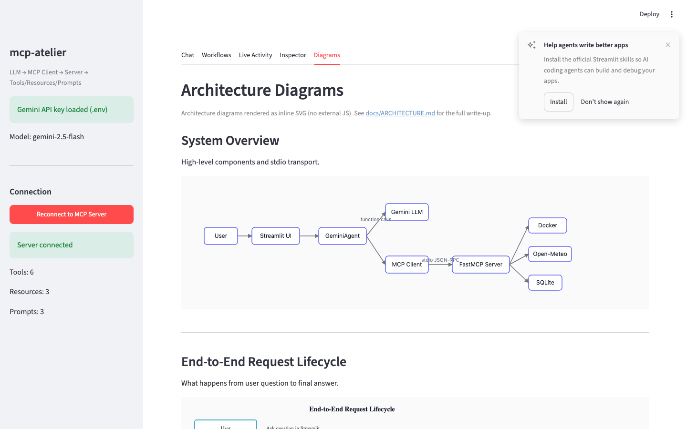
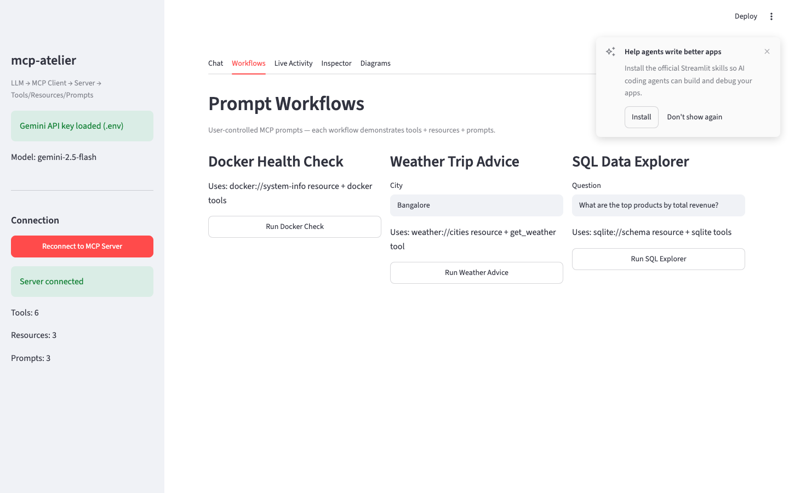
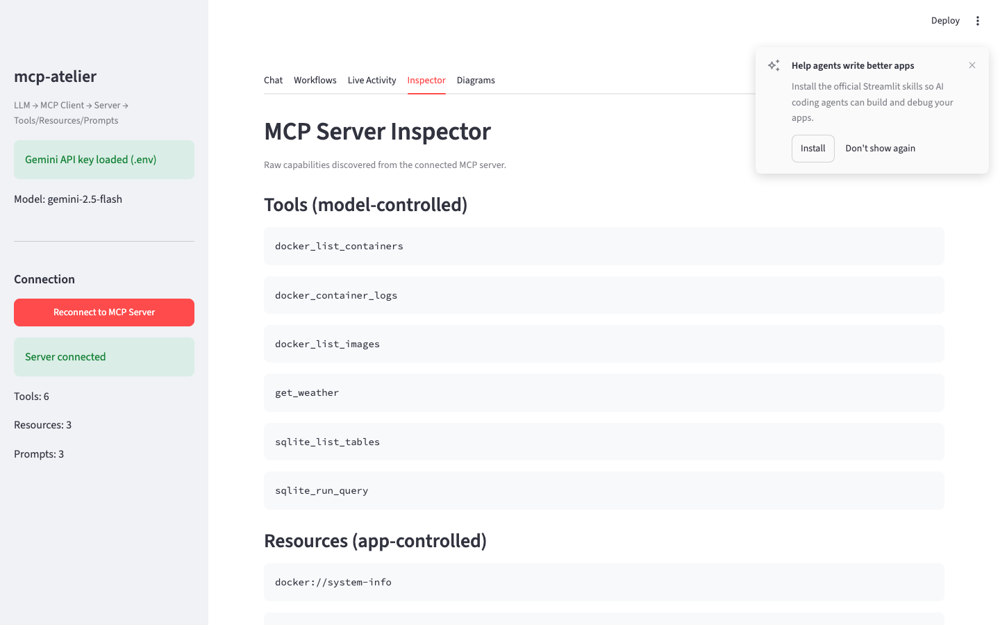
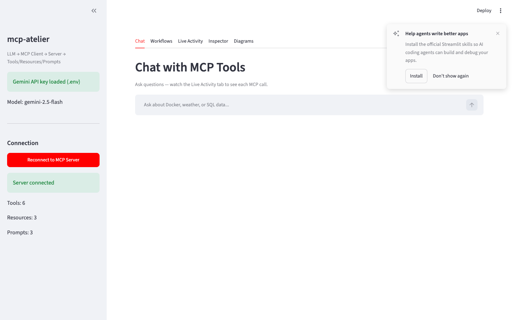

# mcp-atelier

**MCP workshop for building and operating LLM agents** — live tracing, structured errors, and observability built in.

A hands-on Python lab for learning the [Model Context Protocol (MCP)](https://modelcontextprotocol.io/) end to end:

```
User → Streamlit UI → Gemini (LLM) → MCP Client → MCP Server → Docker / Weather / SQLite
                              ↑__________________________________|
                                    tool results flow back
```

Watch every step in the **Live Activity** tab — LLM reasoning, JSON-RPC over stdio, tool calls, and errors.

---

## Screenshots

### See inside the agent loop

Every LLM request, tool call, and MCP round-trip — timestamped, color-coded, with expandable JSON payloads.

<p align="center">
  
</p>

### Chat with real tools

Ask a question. Gemini picks the MCP tool. You get an answer — and a full trace of what happened.

<p align="center">
  
</p>

### Architecture at a glance

<p align="center">
  <table>
    <tr>
      <td align="center"><br/><sub>Inline SVG diagrams — no CDN required</sub></td>
      <td align="center"><br/><sub>One-click workflows using prompts + resources</sub></td>
    </tr>
  </table>
</p>

<p align="center">
  <table>
    <tr>
      <td align="center"><br/><sub>Inspector — 6 tools, 4 resources, 3 prompts</sub></td>
      <td align="center"><br/><sub>Connect once — stdio MCP server spawns automatically</sub></td>
    </tr>
  </table>
</p>

---

## What you get

| | |
|---|---|
| **6 MCP tools** | Docker containers/images/logs, weather, SQLite queries |
| **4 MCP resources** | System info, city list, DB schema, table previews |
| **3 MCP prompts** | Guided workflows (Docker health, trip weather, SQL explorer) |
| **Live tracing** | Step-by-step timeline with JSON payloads |
| **Production patterns** | Safe tool wrappers, structured errors, partial resource preload |

---

## Prerequisites

| Requirement | Required? | Notes |
|-------------|-----------|-------|
| Python 3.10+ | Yes | |
| [Gemini API key](https://aistudio.google.com/apikey) | Yes | Free tier works |
| Docker Desktop | No | Only for Docker tools; weather + SQLite work without it |

---

## Quick start

### 1. Clone and enter the project

```bash
git clone https://github.com/shunvel/mcp-atelier.git
cd mcp-atelier
```

### 2. Create a virtual environment

```bash
python3 -m venv .venv
source .venv/bin/activate        # Windows: .venv\Scripts\activate
pip install -r requirements.txt
```

### 3. Add your API key (local only — never commit this)

```bash
cp .env.example .env
```

Open `.env` and set:

```env
GEMINI_API_KEY=your_key_from_google_ai_studio
```

> **Important:** `.env` is gitignored. Only `.env.example` (empty template) is in the repo.

### 4. Create the demo database

```bash
python scripts/init_db.py
```

### 5. Launch the UI

```bash
streamlit run ui/app.py
```

Or use the helper script:

```bash
./scripts/run_ui.sh
```

### 6. Connect and explore

1. In the sidebar, confirm **Gemini API key loaded**
2. Click **Connect to MCP Server**
3. Open **Chat** or **Workflows**
4. Watch **Live Activity** to see every internal call

---

## Try these prompts

**Chat**
- "What Docker containers are running?"
- "What's the weather in Bangalore?"
- "Show me the top products by revenue"

**Workflows tab** (uses MCP prompts)
- Docker health check
- Weather trip advice
- SQL data explorer

**Error handling demos**
- Ask weather for `"Atlantis"` → structured tool error → LLM explains
- Stop Docker Desktop, ask about containers → graceful failure

---

## Project structure

```
mcp-atelier/
├── server/              # FastMCP server (tools, resources, prompts)
├── client/              # MCP client, Gemini agent, error handling, tracer
├── ui/                  # Streamlit app + architecture diagrams
├── scripts/             # init_db.py, run_ui.sh
├── docs/                # Architecture, error handling, production guide
├── data/                # demo.db (generated, gitignored)
├── requirements.txt
├── .env.example         # Template only — no secrets
└── LICENSE              # MIT
```

---

## How it works

1. **Streamlit** spawns the MCP server as a subprocess (stdio JSON-RPC).
2. **Gemini** receives tool schemas and decides when to call them (function-calling).
3. **MCP client** executes tool calls via `safe_call_tool` — failures become structured JSON, not crashes.
4. **Tracer** records every event for the Live Activity timeline.

The LLM decides tool calls — there are no hard-coded `if` branches for routing.

---

## Configuration

| Variable | Default | Description |
|----------|---------|-------------|
| `GEMINI_API_KEY` | *(required)* | From [Google AI Studio](https://aistudio.google.com/apikey) |
| `GEMINI_MODEL` | `gemini-2.5-flash` | Gemini model name |
| `MCP_SERVER_CMD` | *(auto)* | Leave unset to use the same Python as the UI |
| `SQLITE_DB_PATH` | `data/demo.db` | Demo database path |

---

## Documentation

| Doc | Contents |
|-----|----------|
| [docs/ARCHITECTURE.md](docs/ARCHITECTURE.md) | System design and flow diagrams |
| [docs/OPERATIONAL_EXCELLENCE.md](docs/OPERATIONAL_EXCELLENCE.md) | Production resilience, observability, checklist |
| [docs/ERROR_HANDLING.md](docs/ERROR_HANDLING.md) | How this lab implements error handling |

---

## Troubleshooting

### `ModuleNotFoundError: No module named 'mcp'`

You're not using the project virtualenv:

```bash
source .venv/bin/activate
streamlit run ui/app.py
```

### `GEMINI_API_KEY not set`

- Copy `.env.example` → `.env` (not the other way around)
- Put your key in `.env` only

### Connect button does nothing

- Refresh the browser after clicking Connect
- Check **Live Activity** for handshake events

### Docker tools fail

- Start Docker Desktop, or use weather/SQLite tools instead

---

## Security

- **Never commit** `.env` or API keys
- `.env` is in `.gitignore`; `.env.example` has an empty key placeholder
- If you accidentally expose a key, rotate it immediately in [Google AI Studio](https://aistudio.google.com/apikey)

---

## Tech stack

Python 3.10+ · [FastMCP](https://github.com/modelcontextprotocol/python-sdk) · MCP stdio · Google Gemini · Streamlit · Docker SDK · Open-Meteo · SQLite

---

## License

MIT — see [LICENSE](LICENSE).

## Regenerating screenshots

With Streamlit running (`streamlit run ui/app.py`):

```bash
pip install playwright
playwright install chromium
python scripts/capture_screenshots.py
```

Outputs to `docs/images/`.

## Contributing

Issues and pull requests welcome. Do not include API keys or `data/*.db` in commits.
