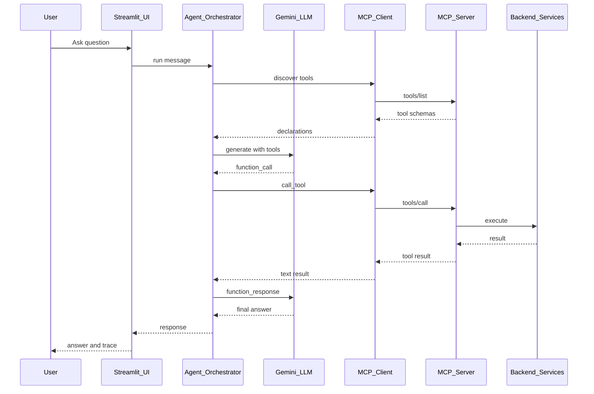
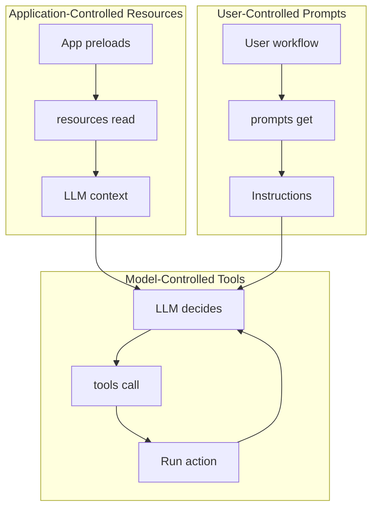
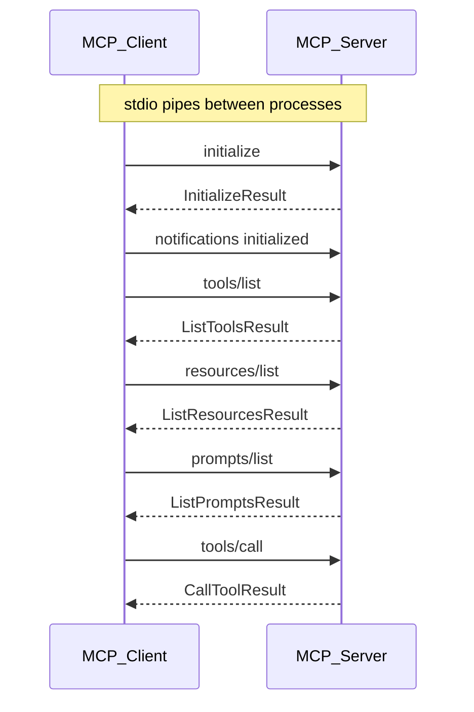
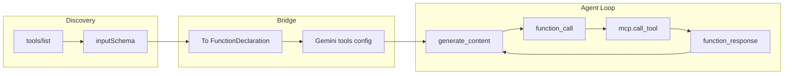

# MCP Learning Lab — Architecture

This document explains the internal flow of the MCP Learning Lab: how the LLM, MCP client, MCP server, and primitives (tools, resources, prompts) interact.

The Streamlit **Diagrams** tab renders these flows as **inline SVG** (see [ui/diagrams.py](../ui/diagrams.py)). Mermaid blocks below are for GitHub/docs viewing.

## 1. End-to-End Request Lifecycle



## 2. Tools vs Resources vs Prompts

Who initiates each MCP primitive:



| Primitive | Who controls | When used | Example |
|-----------|-------------|-----------|---------|
| **Tools** | LLM (model) | LLM decides it needs data or action | `docker_list_containers`, `get_weather` |
| **Resources** | Application | Preloaded before LLM call | `docker://system-info`, `sqlite://schema` |
| **Prompts** | User | User picks a workflow template | `docker_health_check`, `sql_data_explorer` |

## 3. JSON-RPC Message Sequence (stdio transport)



## 4. Gemini Function-Calling Bridge



## 5. Component Map

```
MCP-Exploration/
├── server/main.py          ← FastMCP server (stdio)
│   ├── @mcp.tool()         ← 6 tools (Docker, Weather, SQLite)
│   ├── @mcp.resource()     ← 4 resources (URIs)
│   └── @mcp.prompt()       ← 3 prompt templates
├── client/
│   ├── mcp_client.py       ← stdio transport + traced operations
│   ├── gemini_agent.py     ← LLM loop + tool bridge
│   └── tracer.py           ← event bus for live UI
└── ui/app.py               ← Streamlit (chat, workflows, trace)
```

## 6. Trace Event Types

The live activity panel shows these events in order:

| Event | Direction | Meaning |
|-------|-----------|---------|
| `session.start` | → | Spawning MCP server subprocess |
| `session.initialized` | ← | Handshake complete |
| `mcp.list_tools` | ← | Tools discovered |
| `mcp.list_resources` | ← | Resources discovered |
| `mcp.list_prompts` | ← | Prompts discovered |
| `llm.request` | → | Sending message to Gemini |
| `llm.reasoning` | • | LLM decided to call tools |
| `llm.tool_request` | • | Specific tool + args requested |
| `mcp.call_tool` | → | MCP tool call sent to server |
| `mcp.tool_result` | ← | Tool result received |
| `mcp.read_resource` | → | Reading a resource URI |
| `mcp.resource_result` | ← | Resource content received |
| `mcp.get_prompt` | → | Fetching prompt template |
| `mcp.prompt_result` | ← | Prompt messages received |
| `llm.final` | ← | Final answer from Gemini |
| `mcp.tool_error` | ← | Tool call failed (timeout, protocol, business error) |
| `mcp.resource_error` | ← | Resource read failed |
| `mcp.prompt_error` | ← | Prompt fetch failed |
| `llm.error` | ← | Gemini API call failed |

See [OPERATIONAL_EXCELLENCE.md](OPERATIONAL_EXCELLENCE.md) for production guidance and [ERROR_HANDLING.md](ERROR_HANDLING.md) for lab implementation details.
